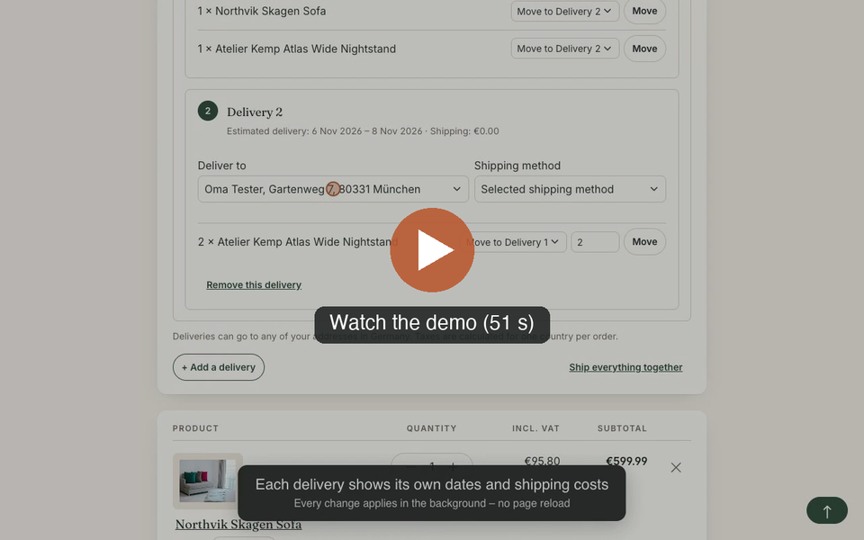
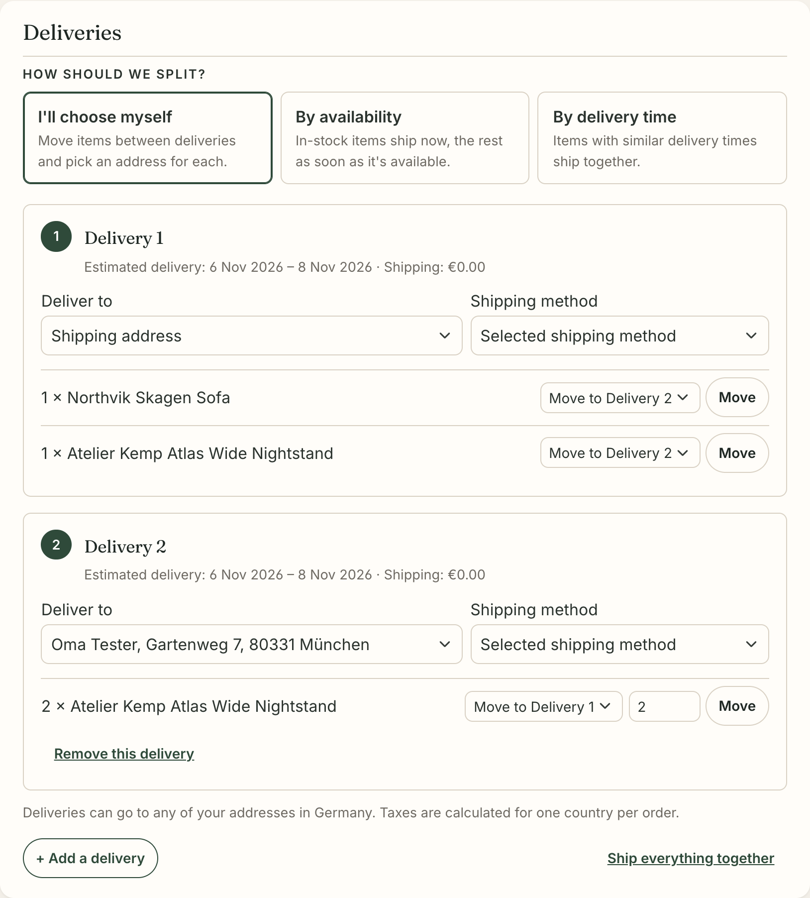

# Multi Delivery

Lets customers split one order into several deliveries on the checkout confirm page. Each delivery can have its own address and shipping method, and the split can follow a rule: the customer's own choice, availability, delivery time or warehouse.

[](docs/video/multi-delivery-demo.mp4)

*[Watch the demo](docs/video/multi-delivery-demo.mp4) (51 seconds): a customer adds a second delivery, moves two items into it and sends it to another address. Every change applies without reloading the page.*

**Contents:** [Features](#features) · [Requirements](#requirements) · [Installation](#installation) · [Configuration](#configuration) · [Order confirmation mail](#order-confirmation-mail) · [Rule Builder](#rule-builder) · [Store API](#store-api) · [How it works](#how-it-works) · [Limitations](#limitations) · [Extending](#extending) · [Development](#development) · [Changelog](CHANGELOG.md) · [Compatibility policy](docs/compatibility.md)

## Features



- **Delivery planner on the confirm page.** Move items, or a part of their quantity, between deliveries, add and remove deliveries, and pick an address and a shipping method per delivery. Changes apply in the background without reloading the page, and the plain forms still work without JavaScript.
- **Splitting rules** (technical name in brackets)
  - *I'll choose myself* (`manual`): the customer creates the deliveries.
  - *By availability* (`availability`): what is in stock ships now, the rest after restock. A product with partial stock is split by quantity.
  - *By delivery time* (`deliveryTime`): one delivery per delivery-time band ("1–3 days", "2–3 weeks", backorders).
  - *By warehouse* (`warehouse`): one delivery per warehouse, using the same allocation logic as SwagCommercial Multi-Warehouse. Shown only when warehouses exist.
- **Adjusting automatic splits.** After an availability or delivery-time split, customers can still move items between the deliveries, and reset to the automatic split.
- **Separate orders** (optional), in two modes: *hybrid* places only deliveries to other countries as separate orders, which Shopware calculates for that country (VAT, prices, shipping rules); *every delivery* places each delivery as an order of its own. See [Deliveries to other countries](#deliveries-to-other-countries).
- **Merchant settings** per sales channel: which rules are offered, the default rule, automatic splitting, delivery-time grouping, and the shipping costs of additional deliveries (charge each, free, or capped at a flat price).
- **Order**: one `order_delivery` per delivery, each with its own address. The delivery's group, label and warehouse are stored in `customFields.mn_multi_delivery`.
- **After the order**
  - The finish page and the customer account list every delivery.
  - With separate orders, the finish page shows every order of the checkout in full: address, shipping and payment method, items and totals.
  - The order confirmation mail lists every delivery with its address.
  - The admin order page has a *Deliveries* tab with status, tracking codes and a delivery note per delivery.
  - B2B order approval pages show the planned deliveries.
- **Store API** for headless clients, with an OpenAPI schema.
- **Rule Builder condition** *Number of deliveries*, so shipping prices, promotions, payment methods and flows can react to a split.
- **Built to be extended**: events, tagged services, decoratable services and Twig blocks, covered by a [compatibility policy](docs/compatibility.md). See [Extending](#extending) and the [example project plugin](examples/MnMultiDeliveryExample).

## Requirements

- Shopware 6.7.14 or newer 6.7 releases (tested in CI with 6.7.14, 6.7.16 and the next minor), PHP 8.2 or newer
- Optional: SwagCommercial with Multi-Warehouse for the warehouse rule

## Installation

```bash
# copy or clone into custom/plugins/MnMultiDelivery
bin/console plugin:refresh
bin/console plugin:install --activate MnMultiDelivery
bin/console theme:compile        # storefront styles
bin/console cache:clear
```

Then turn on **Multi Delivery** in the plugin settings for each sales channel that should offer it.

The storefront JavaScript (`src/Resources/app/storefront/dist`) and the administration (`src/Resources/public`) ship prebuilt. Run `bin/build-storefront.sh` or `bin/build-administration.sh` only after changing their sources.

## Configuration

| Setting | Default | Notes |
|---|---|---|
| Let customers split their order | off | Per sales channel. |
| Payment handlers that keep a single delivery | `Swag\PayPal` | Partial class names, one per line or comma-separated. PayPal only receives the first delivery's shipping cost. |
| Rules customers can choose | all | Limits the four built-in rules; leave empty to offer them all. Rules added by other plugins are always offered and decide themselves with `isAvailable()`. |
| Default rule | I'll choose myself | Used when the customer has not picked one, and as a fallback when a rule is no longer offered. |
| Split automatically | off | The cart arrives already split with the default rule. Customers can still ship everything together. |
| Delivery time: ship together within (days) | 2 | Bands whose dates start this close merge. |
| Delivery time: maximum deliveries | 3 | Once the limit is reached, the latest items ship together. |
| Shipping costs of additional deliveries | charge each | *free*, or *flat*, where the flat price is a cap and never raises a price. The most expensive delivery is always charged normally. |
| Maximum price per additional delivery | 4.90 | Gross; net customers pay it without tax. |
| Deliveries to addresses in another country | only the same country | *Hybrid*: a delivery to another country is placed as an order of its own. *Separate orders*: every delivery is an order of its own. See [Deliveries to other countries](#deliveries-to-other-countries). |
| Payment handlers that allow separate orders | Shopware's invoice, prepayment, cash on delivery, direct debit and default handlers | Partial class names, one per line. Only the main order goes through the payment step, so only methods without an online payment step belong here. |

The delivery-time rule uses the delivery time and restock time you set on products. Without them, every item has the shipping method's delivery time and the rule produces one delivery.

## Deliveries to other countries

By default deliveries stay in the order's shipping country, because Shopware calculates taxes for one country per order. The setting **Deliveries to addresses in another country** has three modes:

| Mode | Setting value | Result |
|---|---|---|
| Only support orders from the same country (default) | `sameCountry` | one order with several deliveries; addresses in other countries are not offered |
| Hybrid: separate orders only for other countries | `separateOrders` | deliveries in the shipping country stay one order; each delivery to another country becomes an order of its own |
| Separate orders: every delivery is its own order | `allSeparate` | each delivery becomes an order of its own, in the shipping country too |

In both separate-order modes customers can also pick addresses in other countries:

- **Hybrid:** each delivery to another country becomes a **separate order** when the customer confirms. Deliveries within the shipping country stay in the main order. Two deliveries to the same other country are two orders.
- **Every delivery:** the delivery to the shipping address (the main delivery; if that is abroad, the first delivery in the shipping country) stays in the main order, every other delivery becomes a separate order. Use it when warehouses, ERP or carriers expect one address per order. With a payment method that doesn't allow separate orders, deliveries in the shipping country stay one order and addresses abroad are not offered, as in the hybrid mode.
- Shopware calculates every separate order for its own address: VAT, tax-free rules, country prices, shipping rules. The confirm page summary shows each order's totals and the sum of all orders.
- Every order has its own number, confirmation mail, invoice, delivery note and states, so ERP, shipping and accounting tools see ordinary one-country orders.
- **Payment:** each order is paid on its own and only the main order goes through the payment step. Separate orders are therefore only offered with the payment handlers in *Payment handlers that allow separate orders*; with other methods foreign addresses are not offered and the planner says why.
- **Promotions and vouchers** stay on the main order. Minimum order values and rules are checked per order.
- **Placing:** every order is calculated first; if one has an error that blocks ordering, nothing is placed and the confirm page shows `error.MN_MULTI_DELIVERY__SEPARATE_ORDER_INVALID`. If placing still fails halfway, the orders already placed are cancelled (their confirmation mails may already be out). Separate orders are placed first, the main order last, and the main order is what the storefront and Store API return. If every delivery goes abroad, the last separate order takes that place.
- The orders of one checkout are linked in the order custom field `mn_multi_delivery_orders` (`group`, `orders[]` with `id`, `orderNumber`, `country`, `countryIso`, `amountTotal`, `currencyIso`).
- **Finish page:** every order of the checkout is shown in full (address, shipping and payment method, items), and the summary lists each order's totals and the sum. Only orders of the logged-in customer are loaded. The customer account lists the linked orders on each order's details.
- **Cart storage:** the main order and every separate order are calculated as copies with tokens of their own, never the customer's cart token. Shopware stores a cart while calculating it when product data was reloaded; those copies are deleted right away, so previews never change the customer's cart.
- With an automatic rule, the items that remain in the main order are split again by that rule (hybrid mode).
- Shipping costs, minimum order values and "free shipping from" rules apply to each order on its own; in the every-delivery mode that affects every split checkout.

## Order confirmation mail

For orders with more than one delivery, a delivery list is added to `order_confirmation_mail` when the mail is sent. Nothing is stored in the templates. It is placed:

1. at `{# mn-multi-delivery #}`, if your template contains that marker,
2. otherwise before Shopware's default address section,
3. otherwise at the end of the mail.

Put `{# mn-multi-delivery:off #}` in a template to switch it off. To change the list itself or its texts, see [Mail](#mail).

## Rule Builder

The condition **Number of deliveries (Multi Delivery)** (`mnMultiDeliveryCount`) sits in the *Cart* group. *Greater than 1* means the order is split. It works anywhere cart rules work: shipping method prices and availability, payment methods, promotions. In flows it counts the order's deliveries.

## Store API

All routes need a logged-in customer (guests included) and use the same logic as the storefront planner. They are part of Shopware's Store API reference (`/store-api/_info/openapi3.json`), which also describes every field.

| Route | Body | Returns |
|---|---|---|
| `GET /store-api/checkout/multi-delivery` | | planner state, see below |
| `POST /store-api/checkout/multi-delivery/toggle` | `{"enabled": true}` | cart |
| `POST /store-api/checkout/multi-delivery/strategy` | `{"strategy": "deliveryTime"}` | cart |
| `POST /store-api/checkout/multi-delivery/group` | `{"groupId": "delivery-2", "addressId": "…", "shippingMethodId": "…"}` | cart |
| `POST /store-api/checkout/multi-delivery/add-group` | | cart |
| `POST /store-api/checkout/multi-delivery/remove-group` | `{"groupId": "delivery-2"}` | cart |
| `POST /store-api/checkout/multi-delivery/move` | `{"lineItemId": "…", "fromGroupId": "main", "toGroupId": "delivery-2", "quantity": 1}` | cart |
| `POST /store-api/checkout/multi-delivery/reset` | | cart |

**Planner state (GET):**

| Field | Meaning |
|---|---|
| `plan` | the delivery plan (see [Data](#data)) |
| `blockReason` | why the cart can't be split (`disabled`, `empty`, `quote`, `subscription`, `recalculation`, `payment`, or a [blocker's](#blocking-addresses-shipping-costs) reason), or `null` |
| `strategies` | the rules the customer may choose |
| `strategy` | the active rule |
| `manualMoves` | the customer creates the deliveries, so `add-group` and `remove-group` are available |
| `adjustable` | items may be moved within the automatic split |
| `adjusted` | the customer has moved items within the automatic split, so `reset` is available |
| `manualGroups` | the deliveries the customer added |
| `moveTargets` | the [group ids](#delivery-groups) items can be moved to |
| `groupNumbers` | the display number per group id |
| `shippingCountryId` | the shipping country |
| `addressIds` | the addresses a delivery may use; with separate orders also addresses in other countries |
| `separateOrders` | separate orders: `enabled`, `mode` (the `countryMode` setting), `paymentAllowed`, `separateGroupIds` (groups that become separate orders), `totalPrice`, and `orders`, one entry per order the checkout will place (separate orders first, the main order last) with `main`, `groupId`, `addressId`, `countryId`, `lineItems` (quantity per cart item), `positionPrice`, `shippingCosts`, `netPrice`, `totalPrice`, `taxStatus`, `calculatedTaxes`, `blockingErrors`. Empty `orders` when the cart has no delivery abroad. |

**Behavior**
- Each delivery in the cart response carries `extensions.mnDeliveryGroup.groupId`.
- `move` with `quantity` 0 moves the whole quantity.
- Input that doesn't fit has no effect: an unknown rule, group or line item, or an address the [address policies](#blocking-addresses-shipping-costs) reject. The address is still stored, but the delivery keeps the shipping address. Move quantities are capped at what the delivery holds.
- When splitting is turned off for the sales channel, every change returns the unchanged cart.
- An unknown action returns 404.
- `POST /store-api/checkout/order` places separate orders like the storefront and returns the main order (or, if every delivery goes abroad, the last separate order). The other orders are in its `customFields.mn_multi_delivery_orders`. Pay every order whose payment is still open; only offline payment handlers are allowed for separate orders.

## How it works

On every cart calculation, `SplitDeliveryProcessor` runs at priority −5050, after Shopware's `DeliveryProcessor` (−5000) has built and priced the single default delivery:

1. `SplitGuard` decides whether the cart may be split. It returns Shopware's single delivery when:
   - splitting is disabled or the cart is empty
   - the cart is a quote or a subscription (SwagCommercial)
   - the cart is an admin recalculation or has manual shipping costs
   - the payment handler is blocked
   - a registered blocker says no
2. The active rule allocates the items to delivery groups, and the customer's adjustments are applied.
3. `DeliveryAllocationEvent` is dispatched.
4. The deliveries are built. Each uses the address and shipping method the customer picked, if the address policies allow it.
5. Shopware prices each delivery by its shipping method, then the shipping cost policy adjusts the prices.
6. `SplitDeliveriesBuiltEvent` is dispatched. With fewer than two deliveries left, Shopware's single delivery stays.
7. `PromotionDeliveryProcessor` (−5100) applies shipping discounts to the final deliveries.

With separate orders enabled, the address policy also accepts addresses in other countries. On the confirm page and in the Store API, `SeparateOrderSplitter` divides the calculated cart along its deliveries (every delivery abroad, or in the every-delivery mode every delivery but the main one, becomes a cart of its own) and `SeparateOrderCalculator` calculates each with a context for its address. When the order is placed, `SeparateOrderCartOrderRoute` (a decorator of Shopware's `CartOrderRoute`) checks the cart hash once, places the separate orders and then the main order through Shopware's own route, links them and dispatches `SeparateOrdersPlacedEvent`.

Shopware's `OrderConverter` writes one `order_delivery` per cart delivery. The primary delivery is the one with the highest shipping costs. The cart hash submitted with the order includes the delivery layout, so a plan changed in another tab is noticed like any other cart change.

## Limitations

- **Deliveries stay in the shipping country** unless separate orders are switched on (see [Deliveries to other countries](#deliveries-to-other-countries)). Shopware calculates taxes for one country per order, so a delivery to another country can't be part of the same order.
- **Separate orders need a payment method without an online payment step**, because only the main order goes through the payment step.
- **PayPal** (default setting): splitting is off, because PayPal receives only one shipping option.
- **Admin order editing and creation** never split. Existing deliveries are kept as they are.
- **Guests** only have the addresses they entered at checkout, so they can split by rule or shipping method but rarely send deliveries to different addresses.
- **The warehouse rule predicts** Commercial's allocation from current stock. If stock changes between checkout and order placement, Commercial's allocation wins and can differ from the deliveries.
- **The per-delivery delivery note** uses `DocumentOrderCriteriaEvent` and `DeliveryNoteOrdersEvent`, which Shopware plans to replace in 6.9.
- **Translations**: German and English.

## Extending

Everything in this section is **public API**: it stays compatible within a major version (see the [compatibility policy](docs/compatibility.md)). Classes marked `@internal` can change in any release. Built-in implementations (the four rules, `SameCountryAddressPolicy`, `ExtraDeliveryCostPolicy`, `DeliveryPlanRoute`) can be replaced through their interface or service id, but the classes themselves may change.

The [example project plugin](examples/MnMultiDeliveryExample) shows most of these extension points working together. The snippets below are taken from it, shortened.

| You want to … | Use |
|---|---|
| add a splitting rule | `DeliverySplitStrategyInterface`, tag `mn.multi_delivery.strategy` |
| change a split after the rule ran | `DeliveryAllocationEvent` |
| change or cancel the built deliveries | `SplitDeliveriesBuiltEvent` |
| forbid splitting for some carts | `SplitBlockerInterface`, tag `mn.multi_delivery.blocker` |
| decide which addresses a delivery may use | `DeliveryAddressPolicyInterface`, tag `mn.multi_delivery.address_policy` |
| price additional deliveries differently | decorate `ShippingCostPolicyInterface` |
| react to the customer's changes | `DeliveryPlanChangedEvent` |
| add data to the order deliveries | `SeparateOrdersPlacedEvent` | after a checkout placed separate orders for deliveries to other countries and linked them | read `getOrderGroupId()`, `getOrders()` (main order last) |
| `SplitOrderConvertedEvent` |
| change the Store API | decorate `AbstractDeliveryPlanRoute` |
| use the split in shipping prices, promotions or flows | Rule Builder condition `mnMultiDeliveryCount` |
| change the planner or the delivery overview | [Twig blocks](#storefront), snippets |
| change the mail | [mail templates](#mail), snippets |
| change the admin tab | [`mn-multi-delivery-card`](#administration) and its blocks |

### Splitting rules

```php
/** Rule "By size": items from 30 kg ship by freight, the rest by parcel. */
class BulkyGoodsStrategy implements DeliverySplitStrategyInterface
{
    public function getName(): string { return 'bulky'; }
    public function isAvailable(SalesChannelContext $context): bool { return true; }
    public function allowsManualMoves(): bool { return false; }
    public function allowsAdjustments(): bool { return true; }

    public function allocate(array $roots, DeliveryPlan $plan, SalesChannelContext $context): Allocation
    {
        $quantities = [];
        foreach ($roots as $id => $root) {
            $weight = $root->lineItem->getDeliveryInformation()?->getWeight() ?? 0.0;
            $quantities[$id] = [$weight >= 30.0 ? 'freight' : 'parcel' => $root->getQuantity()];
        }

        return new Allocation([new DeliveryGroup('parcel', 'parcel'), new DeliveryGroup('freight', 'freight')], $quantities);
    }
}
```

```php
$services->set(BulkyGoodsStrategy::class)->tag('mn.multi_delivery.strategy', ['priority' => 120]);
```

**The contract**

| Method or type | Meaning |
|---|---|
| `getName()` | technical name: used in the settings, the Store API and the snippets `mnMultiDelivery.strategies.<name>` and `mnMultiDelivery.strategyHints.<name>` |
| `isAvailable()` | whether the rule is offered in this context; the warehouse rule returns false without warehouses |
| `allowsManualMoves()` | whether customers create the deliveries themselves (`add-group` and `remove-group`), like `manual` |
| `allowsAdjustments()` | whether customers may move items between the deliveries the rule created; stored per rule in the plan, and ignored when they no longer fit the cart (for example after a quantity change) |
| `allocate($roots, …)` | `$roots` are the top-level cart items, keyed by line item id. Each `RootItem` has `lineItem`, `positions` (its delivery positions with Shopware's delivery dates) and `getQuantity()`. `isSplittable()` is false for containers such as bundles, which must go to a single group. |
| `Allocation` | the groups in display order, plus the quantity of each root item per group id. Every root item needs an entry; quantities must use known group ids, otherwise the constructor throws. Groups without items are not created. |
| `DeliveryGroup` | `id`: 1–64 letters, digits or dashes; stable, because the customer's address and shipping method are stored per id. `label` is stored on the order delivery. `inStockDates`: date partial quantities by the normal delivery time instead of the restock date. `warehouseId` and `warehouseName` are shown to customers and stored on the order. `locked` is informational (`DeliveryGroupInfo::isLocked()`). |

Higher priorities are listed further up. Add the snippets. The *Rules customers can choose* setting doesn't apply to your rule: it is offered whenever `isAvailable()` returns true, so put your own switch there if merchants need one.

### Events

| Event | Dispatched | You can |
|---|---|---|
| `DeliveryAllocationEvent` | in the cart calculation, after the rule and the customer's adjustments | `setAllocation()`, read `getRoots()`, `getStrategy()`, `getPlan()`, `getCart()` |
| `SplitDeliveriesBuiltEvent` | after the deliveries are built and priced, before they replace Shopware's single delivery | change the deliveries in place, or `setDeliveries()`; fewer than two cancels the split |
| `DeliveryPlanChangedEvent` | after the customer changed the plan (storefront or Store API) and the cart was recalculated | read `getAction()` (`ACTION_*`), `getPlan()`, `getCart()` |
| `SplitOrderConvertedEvent` | when a split cart becomes an order, after the group data was written to the order deliveries | `setConvertedCart()`, e.g. to add custom fields per delivery |

All events implement `ShopwareSalesChannelEvent`. The allocation and built events run on every cart calculation, so keep them fast.

```php
/** Gift cards always ship with the first delivery, whatever the rule. */
public function onAllocation(DeliveryAllocationEvent $event): void
{
    $allocation = $event->getAllocation();
    $first = array_key_first($allocation->groups);
    foreach ($event->getRoots() as $id => $root) {
        if (($root->lineItem->getPayload()['productNumber'] ?? null) === 'GIFT-CARD') {
            $allocation = $allocation->withQuantities($id, [$first => $root->getQuantity()]);
        }
    }
    $event->setAllocation($allocation);
}
```

### Blocking, addresses, shipping costs

```php
/** Carts with pre-order items (product custom field "example_preorder") ship in one delivery. */
class PreorderBlocker implements SplitBlockerInterface
{
    public function blockReason(Cart $cart, SalesChannelContext $context, CartBehavior $behavior): ?string
    {
        foreach ($cart->getLineItems()->getFlat() as $lineItem) {
            if (($lineItem->getPayload()['customFields']['example_preorder'] ?? false) === true) {
                return 'preorder';
            }
        }

        return null;
    }
}
```

Tag it with `mn.multi_delivery.blocker`. Blockers run after the built-in checks. The customer sees the snippet `mnMultiDelivery.blocked.<reason>`, and the Store API returns the reason as `blockReason`.

**Address policies** implement `isAllowed(CustomerAddressEntity $address, SalesChannelContext $context): bool` and are tagged `mn.multi_delivery.address_policy`. An address must pass every policy. The default `SameCountryAddressPolicy` keeps deliveries in the shipping country. To replace it, decorate it; the decorator takes over its tag:

```php
$services->set(MyAddressPolicy::class)->decorate(SameCountryAddressPolicy::class);
```

Read [Limitations](#limitations) before allowing other countries.

**Shipping costs**: decorate `ShippingCostPolicyInterface`. `apply(DeliveryCollection $deliveries, SalesChannelContext $context)` runs after Shopware priced each delivery, so change the deliveries' shipping costs there:

```php
$services->set(MyShippingCostPolicy::class)
    ->decorate(ShippingCostPolicyInterface::class)
    ->args([service('.inner')]);
```

### Store API

```php
$services->set(MyDeliveryPlanRoute::class)
    ->decorate(AbstractDeliveryPlanRoute::class)
    ->args([service('.inner')]);
```

`MyDeliveryPlanRoute` extends `AbstractDeliveryPlanRoute`, returns the inner route from `getDecorated()`, and implements `load()` (returning a `DeliveryPlanRouteResponse`) and `change()` (returning a `CartResponse`).

### Storefront

Customize the templates with `` and these blocks. Keep the form actions and field names: the storefront plugin and the controller rely on them.

- **Planner**, `@Storefront/storefront/component/mn-multi-delivery/planner.html.twig`:
  - `component_mn_multi_delivery`, with `_heading`, `_blocked`, `_intro`
  - `_strategies`, `_strategy_option`
  - `_list`, `_item`, `_item_header`, `_item_title`, `_item_meta`
  - `_item_settings`, `_item_address`, `_item_shipping_method`
  - `_item_positions`, `_item_position`, `_item_position_label`, `_item_position_move`
  - `_item_remove`, `_empty_item`, `_hint`, `_actions`
  - `_item_separate_order` (the "Separate order · country" badge of a delivery abroad)

  Inside a delivery the variables `delivery`, `info` (`mnDeliveryGroup`), `groupId`, `groupNumber` and `settings` are available.
- **Overview** on the finish page, the account and the approval pages, `@Storefront/storefront/component/mn-multi-delivery/delivery-overview.html.twig`: `component_mn_delivery_overview`, with `_heading`, `_item`, `_item_summary`, `_item_address`, `_item_positions`.
- **Separate orders** (hybrid and every-delivery mode):
  - Summary on the confirm and finish pages, `@Storefront/storefront/page/checkout/summary.html.twig`: `page_checkout_summary_mn_separate_order` (one order's totals, variables `mnOrder` and `summary`) and `page_checkout_summary_mn_separate_total` (sum of all orders).
  - One order on the finish page, `@Storefront/storefront/component/mn-multi-delivery/finish-order.html.twig`: `component_mn_multi_delivery_finish_order`, with `_header`, `_meta`, `_items`; variable `mnOrder`.
  - List of the linked orders on the finish page and the account's order details, `@Storefront/storefront/component/mn-multi-delivery/separate-orders.html.twig`: `component_mn_multi_delivery_separate_orders`; variable `order`.
  - Page data: on the confirm page `page.extensions.mnMultiDelivery.separateOrders` (as in the Store API, plus `cart` and `country` per order); on the finish page `page.extensions.mnSeparateOrders` with `orders` (all orders, main order last), `others` and `totalPrice`.

The storefront plugin `MnMultiDelivery` sits on `[data-mn-multi-delivery]`. Its options (`data-mn-multi-delivery-options`):
- `updatingText` and `updatedText`
- `summarySelector`, `hashSelector` and `submitSelector`
- `loadingClass`

After each background change it publishes `updated`:

```js
const plugin = window.PluginManager.getPluginInstances('MnMultiDelivery')[0];
plugin?.$emitter.subscribe('updated', () => { /* e.g. refresh your own widget */ });
```

### Mail

The delivery list is `mn-multi-delivery/mail/order-deliveries.html.twig` and `order-deliveries.txt.twig`. Ship the same path in your plugin or theme to replace it. The templates get the mail's variables, with:
- `order` and `currencyIsoCode`
- `mnDeliveryTexts`: the texts `heading`, `delivery`, `shipsFrom`, `deliverTo` and `expected`, from the snippets `mnMultiDelivery.mail.*`. They can be changed under *Settings › Snippets*.

In the plain-text version, end every text line with output (`{{ }}`), not a tag: Twig drops the newline after a tag.

### Administration

`mn-multi-delivery-card` is the content of the *Deliveries* tab (route `mn.multi.delivery.order.detail.deliveries`). Override it with `Shopware.Component.override('mn-multi-delivery-card', …)` and the blocks:
- `mn_multi_delivery_card`
- `mn_multi_delivery_card_details`
- `mn_multi_delivery_card_address`
- `mn_multi_delivery_card_shipping`
- `mn_multi_delivery_card_items`
- `mn_multi_delivery_card_actions`

### Data

- **Cart:** the `mnDeliveryPlan` extension (`DeliveryPlan`): `enabled`, `strategy`, settings per group, manual assignments, added groups, and adjustments per rule. Each cart delivery has the `mnDeliveryGroup` extension (`DeliveryGroupInfo`): `groupId`, `label`, `locked`, `warehouseId`, `warehouseName`.
- **Order:** `order_delivery.customFields.mn_multi_delivery` holds `group`, `label`, `warehouseId` and `warehouseName`. It is registered as the custom field set *Multi Delivery*.
- **Order (separate orders):** `order.customFields.mn_multi_delivery_orders` holds `group` and `orders[]` (`id`, `orderNumber`, `country`, `countryIso`, `amountTotal`, `currencyIso`) on every order of the checkout. It is registered as the custom field set *Multi Delivery – orders placed together*.
- **Settings:** `MnMultiDelivery.config.countryMode` (`sameCountry`, `separateOrders`, `allSeparate`) and `MnMultiDelivery.config.separateOrderPaymentHandlers`, besides the settings in [Configuration](#configuration).
- **Errors:** `MultiDeliveryException` (extends `CartException`) with `MN_MULTI_DELIVERY__SEPARATE_ORDER_PAYMENT` and `MN_MULTI_DELIVERY__SEPARATE_ORDER_INVALID`; the storefront shows the snippets `error.<code>`.
- **Snippets:** `mnMultiDelivery.*` (storefront and mail, separate orders under `mnMultiDelivery.separate.*`), `mn-multi-delivery.*` (administration, the settings explanation under `mn-multi-delivery.countryMode.*`).

#### Delivery groups

| Rule | Group ids | Label |
|---|---|---|
| `manual` | `main` (the first delivery), `delivery-2`, `delivery-3`, … | delivery number |
| `availability` | `now`, `later` | `now`, `later` |
| `deliveryTime` | `time-1`, `time-2`, … in date order | band number |
| `warehouse` | `wh-<warehouse id>`; `main` for what no warehouse covers (non-product items, bundles, remaining quantities) | warehouse name; `main` |

## Development

```bash
# without a shop: Shopware and the dev tools from Composer
composer install
composer test                               # unit tests
composer phpstan                            # PHPStan, level 8

# unit tests from the plugin directory inside a Shopware installation (no database needed)
php phpunit.phar --testsuite unit          # or: SHOPWARE_DIR=/path/to/shop php phpunit.phar --testsuite unit

# integration tests against the installation, with the plugin active
MN_MULTI_DELIVERY_SALES_CHANNEL_ID=<storefront id> MN_MULTI_DELIVERY_CUSTOMER_ID=<customer id> \
    php phpunit.phar --testsuite integration
```

The unit suite covers:
- the rules, the plan, the guard and blockers
- the processor with its events and policies
- shipping costs, adjustments and moves
- the Rule Builder condition
- the mail block, including template overrides
- the cart hash
- the example plugin
- allocation parity with SwagCommercial (skipped when Commercial is missing)

The integration tests calculate real carts and convert one into an order payload. They write nothing: carts stay in memory, the order is not persisted, and settings are overridden in the test process only. Without the variables they are skipped.

After changing the storefront JavaScript or the administration, run `bin/build-storefront.sh` or `bin/build-administration.sh` and commit the built files.

## License

MIT
